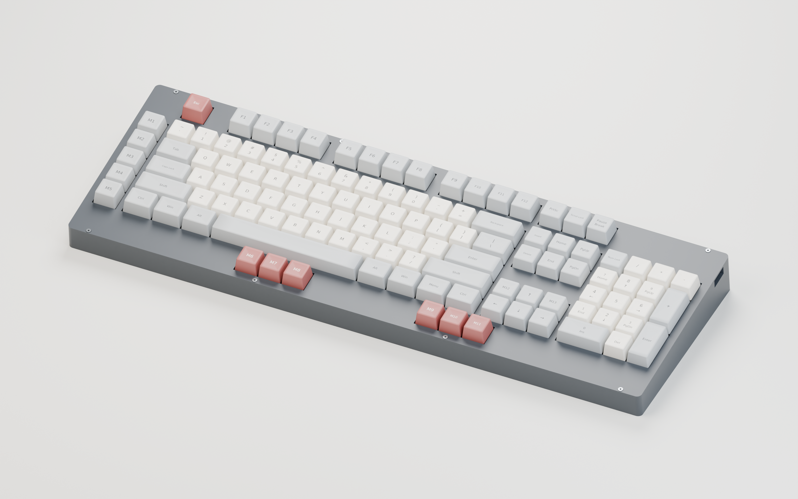

# Cleaver keyboard

A keyboard for my best tantrum buddy Cleaver: 117 hot-swap MX keys, with RGB and
single-color lighting variants.

## Revision 0.6 showcase

**Current PCB: [rev0.8](designs/module-rp2040/manufacturing/rev0.8/README.md)** adds
a [replaceable illuminated logo](designs/module-rp2040/LOGO.md) between the two
front three-key clusters, with matching square plate/cover openings.
The rendering below shows the historical rev0.6 direct-header assembly.

[](designs/module-rp2040/mechanical/rev0.6/case/renderings/Cleaver-rev0.6-assembled.png)

Rendered from the actual rev0.6 case, populated PCB and switch plate, with all
117 switches, modeled keycaps, stabilizers and mounting hardware assembled.
Colors and keycap profiles are illustrative; RGB is shown off.
[Full-resolution render and reproduction details](designs/module-rp2040/mechanical/rev0.6/case/renderings/README.md).

| Feature | Revision 0.8 |
| --- | --- |
| Layout | 117 keys: full-size typing area, numpad, navigation/arrow cluster, left macro column and extra front macro keys |
| Switches | Hot-swap MX, Cherry-compatible **plate-mount stabilizers**, 6.25u spacebar |
| Controller | **Waveshare RP2040-Plus 4MB**, removable via underside SMT sockets; right-facing USB-C |
| Lighting | **117 per-key + 4 logo RGB LEDs**, reverse-mounted; protected USB LED supply |
| Replaceable logo | **16 mm square badge**, printed light well, 16.4 mm plate/cover openings; QMK/Vial color control |
| Firmware | **QMK / Vial**, with key remapping, macros and RGB control; default and Vial UF2 builds included |
| Enclosure | **5° rear-raised case**, 11 M2 PCB standoffs, controller-socket backstops, removable cover and USB-C opening |
| Dimensions | PCB: **452.44 × 147.64 × 1.6 mm**; case base: approximately **466 × 164 mm** |

### Build and explore

- **Electronics:** [design and assembly guide](designs/module-rp2040/README.md),
  [rev0.8 fabrication package, BOM and placement files](designs/module-rp2040/manufacturing/rev0.8/README.md).
- **Case and plate:** [STL, STEP, FreeCAD assembly and fit coupons](designs/module-rp2040/mechanical/rev0.8/case/README.md),
  [matching switch/stabilizer/logo plate](designs/module-rp2040/mechanical/rev0.8/README.md).
- **Firmware:** [ready-to-flash UF2 files and instructions](designs/module-rp2040/manufacturing/rev0.8/firmware/README.md),
  [firmware source and configuration](designs/module-rp2040/firmware/README.md).
- **Look inside:** [populated PCB previews](designs/module-rp2040/previews/README.md),
  [case interior and mounting plan](designs/module-rp2040/mechanical/rev0.8/case/case-plan.svg),
  [recorded validation and remaining prototype checks](designs/module-rp2040/VALIDATION.md).

> **Prototype status:** Electrical/layout checks and firmware builds have recorded
> passing results; physical hardware operation and case fit remain unverified.
> Print the fit coupons first. The case and plate are full-size, unsplit parts;
> the case needs approximately a 466 × 164 mm print area **plus brim clearance**.
> Use the specified long module headers and matching rev0.8 base/plate/cover. JLCPCB
> engineering/placement approval and physical socket mating remain required.

## Choose a hardware design

| Design | Open in KiCad | Documentation |
| --- | --- | --- |
| **Module RP2040 — rev0.8:** socketed Waveshare RP2040-Plus, per-key RGB and illuminated badge | [Cleaver.kicad_pro](designs/module-rp2040/Cleaver.kicad_pro) | [Design and assembly](designs/module-rp2040/README.md), [manufacturing](designs/module-rp2040/manufacturing/README.md) |
| **Embedded RP2040 — embedded-0.2:** onboard RP2040 and USB-C, per-key RGB | [Cleaver-Embedded.kicad_pro](designs/embedded-rp2040/Cleaver-Embedded.kicad_pro) | [Design and status](designs/embedded-rp2040/README.md), [handoff](designs/embedded-rp2040/HANDOFF.md) |
| **Single-color devboard — white-0.1:** YD-RP2040 module, white backlight | [Cleaver-White.kicad_pro](designs/single-color-devboard/Cleaver-White.kicad_pro) | [Design and status](designs/single-color-devboard/README.md), [manufacturing](designs/single-color-devboard/manufacturing/README.md) |

Each design owns its KiCad libraries, firmware, generation tools, validation,
and manufacturing files. Read its documentation for revision and prototype status.

## Repository layout

```text
assets/                        Shared layout inputs and silkscreen artwork
designs/
  module-rp2040/               Original RGB module design, mechanics and releases
  embedded-rp2040/             Integrated-controller RGB design
  single-color-devboard/       Module-based white-backlight design
docs/                          Repository organization and path migration guide
tools/                         Cross-design utilities and repository checks
```

- [Design comparison](designs/README.md)
- [Repository structure and file-placement conventions](docs/REPOSITORY.md)
- [Original keyboard layout](assets/layout/README.md)
- [Taviana artwork, previews and recorded checks](assets/artwork/taviana/README.md)
- [Tools and verification commands](tools/README.md)
