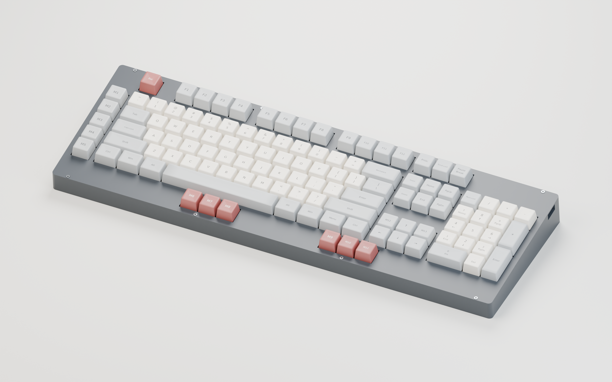

# Rev0.6 — fully assembled product rendering



[Full-resolution PNG](Cleaver-rev0.6-assembled.png) ·
[Render provenance](Cleaver-rev0.6-assembled.json)

This is a **Blender/Cycles render of the actual rev0.6 CAD**, not an AI-generated
keyboard image. The closed, opaque enclosure naturally hides the PCB and most
of the switch/assembly hardware; those parts are present in the scene, not
omitted or replaced with a generic keyboard.

## Included assembly

- Actual **5° tilted case and separate removable bezel**, imported from the
  validated case STLs and restored to their assembly coordinates.
- Actual rev0.6 **populated PCB**, exported read-only by KiCad with its local
  component models, mounting holes, LED windows, pads, mask and silkscreen.
  Includes the Waveshare RP2040-Plus, **117 MX switches, 117 hot-swap sockets,
  117 reverse-mount RGB LEDs**, underside C5 and the other populated passives.
- Actual **1.5 mm switch/stabilizer plate**, 3.5 mm plate spacing and all 11 PCB
  mounting positions.
- **117 sculpted, rounded/dished keycaps**, with legends and sizes from the
  original KLE layout, including the left macro column, extra front macro keys,
  6.25u spacebar and tall numpad keys.
- Eleven spacers, 19 M2 inserts, 11 PCB/plate screws, eight cover screws and
  eight plate-mount stabilizer assemblies.

The **charcoal case, warm-white/grey keycaps and muted red accents are an
illustrative color scheme**. Keycap profiles, stabilizers and threaded hardware
are visual approximations, not supplier-qualified CAD or new fabrication parts.
The bundled component-model approximations still apply. RGB is shown **off**;
this is not a calibrated prediction of LED brightness or light diffusion.
The image does not establish physical fit, printer finish or prototype validation.

Component geometry credits: KiCad community, KiSwitch / Rafael Silva and
contributors, and ebastler / marbastlib. Their pinned sources, modifications and
licenses remain in the [component-model documentation](../../../../Cleaver.3dshapes/README.md#sources-modifications-and-licenses).
Legends use DejaVu Sans.

## Reproduce

Requires KiCad 10, Blender with Cycles, and the committed rev0.6 case/plate files.
Run from the repository root. The intermediate GLB can be regenerated anywhere;
the example uses `/tmp/opencode` and never changes the PCB.

```sh
kicad-cli pcb export glb --subst-models --include-pads --include-silkscreen --include-soldermask --user-origin 0x0mm --output /tmp/opencode/Cleaver-rev06-render-pcb.glb designs/module-rp2040/Cleaver.kicad_pcb
blender --background --factory-startup --python-exit-code 1 --python designs/module-rp2040/source/render_assembly.py -- --pcb /tmp/opencode/Cleaver-rev06-render-pcb.glb
```

Use `--draft --output /tmp/opencode/cleaver-render-draft` for a smaller preview.
`--save-scene /tmp/opencode/Cleaver-rev0.6-assembled.blend` retains an editable,
packed Blender scene with named collections for the enclosure, populated PCB,
caps, hardware and studio. The default render is **3000 × 1875 px**, 128 Cycles
samples with adaptive sampling and denoising. All geometry is converted from
millimetres to metres consistently before lighting/rendering.

The adjacent JSON records source hashes, component counts, Blender version,
render settings, material assumptions and the resulting image hash.
