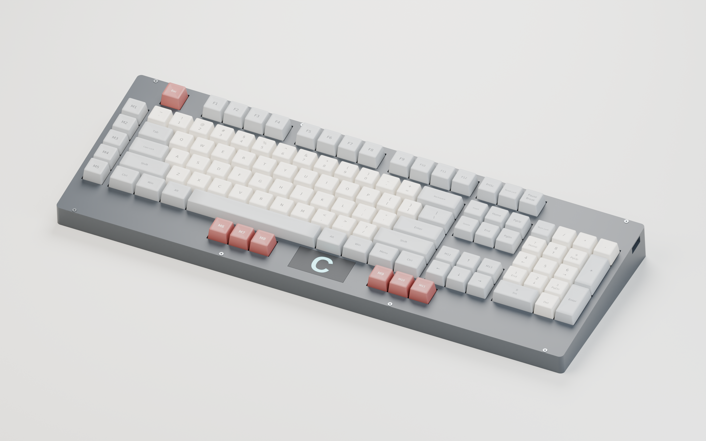

# Rev0.9 — 2 × 1 inch illuminated-logo assembly



[Full-resolution PNG](Cleaver-rev0.9-assembled.png) ·
[Render provenance](Cleaver-rev0.9-assembled.json)

Blender/Cycles rendering of the **actual rev0.9 CAD**. The replaceable badge is
**50.8 mm wide × 25.4 mm tall**, centered horizontally between M6–M8 and M9–M11.
The front bezel is 8 mm deeper, with all 117 key positions retained.

## Included assembly

- Validated **5° case base and removable cover**, restored from their independent
  print-bed orientations, including H9's support at (263,138) mm.
- Current **populated PCB** exported by KiCad: **607 component-model instances
  across 490 footprints**, plus six board/pad/mask/silkscreen meshes. Includes
  the socketed Waveshare RP2040-Plus, 117 MX switches, 117 hot-swap sockets,
  **117 per-key + four badge RGB LEDs**, and the populated passives.
- Actual **1.5 mm switch/stabilizer/logo plate**, with its 8 mm front extension
  restored to PCB coordinates and 3.5 mm PCB-to-plate spacing.
- Actual **light well and removable 50.8 × 25.4 mm insert**, with their matching
  plate/cover apertures. A cyan-emissive surface treatment represents the editable
  template's sample “C” mask over the diffuser.
- **117 sculpted keycaps**, using the original KLE sizes and legends, eleven
  spacers, 19 M2 inserts, 11 PCB screws, eight cover screws and eight stabilizers.

The charcoal enclosure, ivory/stone keycaps, muted red accents and cyan badge
are illustrative. Per-key lighting is off. Keycap profiles, stabilizers and
threaded hardware are visual approximations; bundled PCB-model approximations
also apply. The emissive badge treatment illustrates a masked diffuser's
appearance rather than predicting physical brightness or diffusion.

Component geometry credits: KiCad community, KiSwitch / Rafael Silva and
contributors, and ebastler / marbastlib. Sources, modifications and licenses are
in the [component-model documentation](../../../../Cleaver.3dshapes/README.md#sources-modifications-and-licenses).
Key legends use DejaVu Sans; the sample badge uses Liberation Sans Bold.

## Reproduce

Requires KiCad 10, Blender with Cycles, DejaVu Sans, Liberation Sans Bold and the
committed rev0.9 mechanics. Run from the repository root:

```sh
kicad-cli pcb export glb --subst-models --include-pads --include-silkscreen --include-soldermask --user-origin 0x0mm --output /tmp/opencode/Cleaver-rev09-render-pcb.glb designs/module-rp2040/Cleaver.kicad_pcb
blender --background --factory-startup --python-exit-code 1 --python designs/module-rp2040/source/render_assembly.py -- --pcb /tmp/opencode/Cleaver-rev09-render-pcb.glb
```

The intermediate GLB can be placed anywhere; create the temporary directory if
needed. The renderer follows `REVISION` in `source/design.py`, verifying the PCB,
plate and imported case-part hashes against the validation reports.

Use `--draft --output /tmp/opencode/cleaver-rev09-render-draft` for a smaller
preview, or `--save-scene /tmp/opencode/Cleaver-rev0.9-assembled.blend` to retain a
packed, editable scene. Collections group the enclosure, PCB, caps, hardware,
badge and studio. The final image is **3000 × 1875 px**, with 128 Cycles CPU
samples, adaptive sampling and denoising; geometry uses metres consistently.

The JSON records CAD/render-recipe hashes, component counts, badge dimensions,
font and appearance assumptions, Blender version, settings and the image hash.
